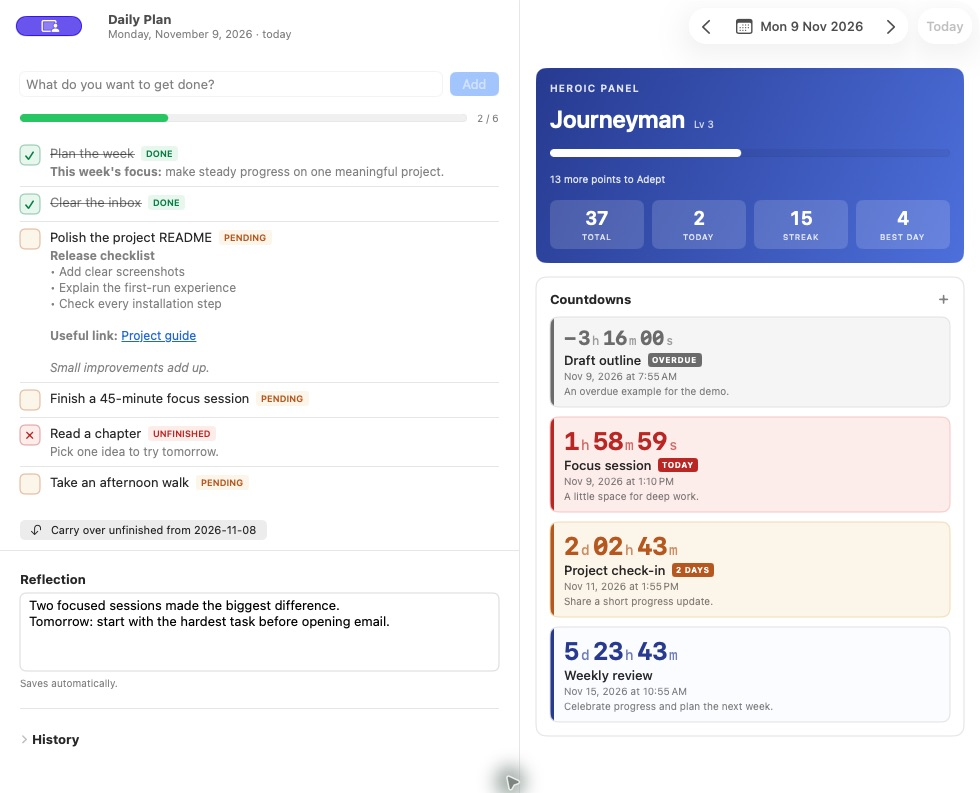
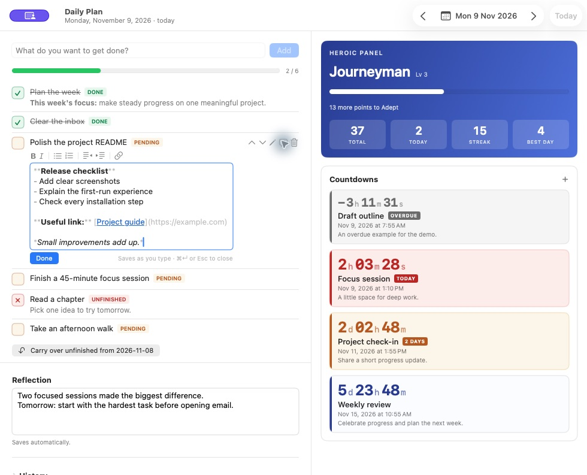
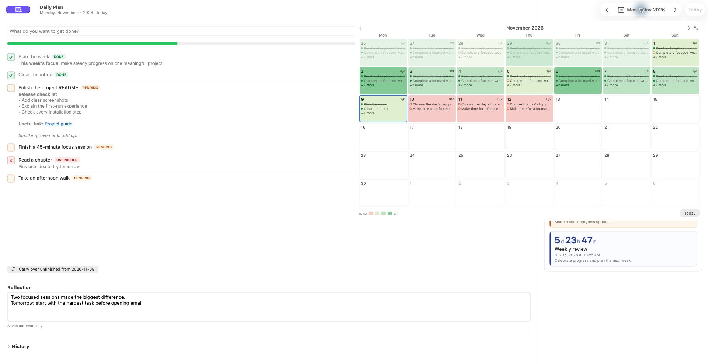
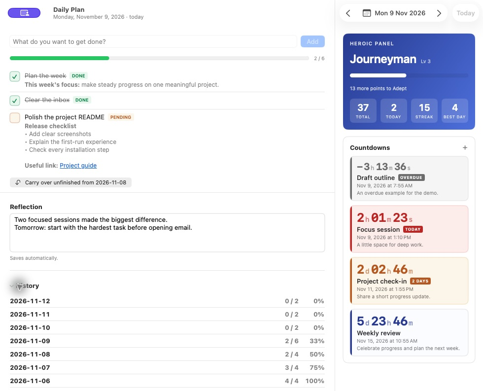
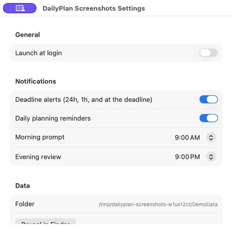

# Daily Plan

A local-first daily planner for macOS. Turn goals into a daily plan, keep
deadlines in view, and review progress without creating an account.

- **Native SwiftUI app:** goals, formatted notes, calendar history and menu-bar countdowns.
- **Local data:** readable JSON and Markdown files, with a rolling backup.
- **Optional [web companion](docs/WEB_COMPANION.md):** a small local Python server and browser UI.

**Source preview:** no packaged public release is available yet. The native distribution targets
**Apple Silicon Macs with macOS 14+**. It is ad-hoc signed, not Developer
ID-signed or notarized. A license has not yet been selected.

[Contributing](CONTRIBUTING.md) · [Security and privacy](SECURITY.md) ·
[Support and donations](SUPPORT.md) · [Changelog](CHANGELOG.md)

## A quick tour

Real screenshots of the native Mac app, using fictional sample goals,
notes and countdowns. No personal tasks are shown. Click a screenshot to view it at full size.

### Plan the day and see your progress



Keep today's goals, notes and reflection together. Mark tasks as pending,
done or unfinished, reorder them, and carry unfinished work into the next day.
The score panel tracks total points, today's progress, streaks and your best day.

The deadline cards distinguish calm, upcoming, urgent and overdue items.
Urgent countdowns show live hours, minutes and seconds.

### Keep useful notes beside each goal



Write notes with bold, italic, lists, indentation and links. Notes save as
you type and remain readable Markdown in your local files.

### See the bigger picture



The calendar colors each day by completion. Expand it to see goals inside
the dates, then jump directly to a day to review or plan ahead.

### Reflect and revisit earlier days



Write a short daily reflection and browse previous days with their scores.
Your history stays in plain JSON and Markdown files on your Mac.

### Choose reminders that fit your day



Set morning planning and evening review times, choose deadline alerts,
and manage launch at login. The Settings view also shows where your data lives.

## Install (native)

```bash
./build_native.sh          # dist-native/DailyPlan.app
./build_native.sh --dmg    # also dist-native/DailyPlan.dmg
```

Drag `DailyPlan.app` into `/Applications` and double-click it. Requires the
Xcode command line tools (`xcode-select --install`) to build; running it needs
nothing.

macOS may block an ad-hoc-signed build as an unidentified developer. Review
the source and build it yourself, or follow your macOS version's Privacy &
Security instructions only for a copy you trust. Do not disable Gatekeeper.
A signed/notarized public release is not available yet.

The app asks permission to send notifications. Allow it if you want deadline alerts.

### Native-only features

- **Menu bar countdown** — your next deadline is always visible, e.g.
  `Project check-in 2d`. It turns orange under four days and red under one.
  Click it for today's goals (click one to mark it done) and your next five
  deadlines.
- **Notifications** — 24 hours before, 1 hour before, and at each deadline.
- **Daily reminders** — a morning prompt to plan and an evening prompt to
  review. Times are configurable in Settings (⌘,).
- **Launch at login** — toggle in Settings.
- **Keyboard shortcuts** — `⌘[` / `⌘]` change day, `⇧⌘T` jumps to today,
  `⌘K` carries over unfinished goals (inside a note it inserts a link instead).
- **Formatted notes, drag to reorder** — see *Notes* below.
- **Feedback menu** — shows zyhozhang@gmail.com and opens a new feedback
  email in your default mail app. Nothing is sent automatically.

## Using it

**Goals.** Type in the box and press <kbd>Enter</kbd>. Paste multiple lines to
add several at once. The same title can't be added twice on one day.

Click the box at the left of a goal to cycle its status:

| Status | Meaning | Markdown |
| --- | --- | --- |
| Pending | Not started or in progress | `[ ]` |
| Done | Finished — earns 1 point | `[x]` |
| Unfinished | Attempted but not completed | `[~]` |

Hover a goal for actions: move up/down, edit the title, attach a note, delete.
In the native build, drag a goal by any part of its row to reorder it (the ≡
in the margin is just a hint), and double-click a title or a note to edit it.
The title is edited in place — <kbd>Enter</kbd> saves,
<kbd>Esc</kbd> cancels, clicking elsewhere keeps the edit.

**Notes** (native build) save as you type; <kbd>⌘↵</kbd>, <kbd>Esc</kbd>, or
**Done** closes the editor. They are stored as plain text with light Markdown,
so `state.json` and the Markdown logs stay readable everywhere — the web build
simply shows the raw text.

| To get | Type, or use the bar above the note | Shortcut |
| --- | --- | --- |
| **bold** | `**bold**` | <kbd>⌘B</kbd> |
| *italic* | `*italic*` | <kbd>⌘I</kbd> |
| bullet | `- item` | |
| numbered | `1. item`, `a) item` | |
| indent / outdent | a leading tab | <kbd>Tab</kbd> on a list item or several lines / <kbd>⇧Tab</kbd> |
| hyperlink | `[text](https://…)` | <kbd>⌘K</kbd>, or paste a URL over selected text |
| link | `https://…` or `www.…` | |

<kbd>Enter</kbd> on a list item starts the next one (`b)` → `c)`, `3.` → `4.`);
on an empty item it ends the list in place. An indented line passes its indent
to the next. <kbd>⌥↵</kbd> is always a plain line break.

When you are not editing, the markup is hidden, bullets are drawn as •, and
links are clickable (<kbd>⌘</kbd>-click while editing).

**Carry over** copies every goal from the previous day that isn't done into
today, marked pending and tagged with where it came from. It skips anything
already on today's list, so pressing it twice is harmless.

**Scoring.** One point per completed goal. Marking a goal back to pending or
unfinished removes the point. The heroic panel shows your total, today's
score, your current streak, and your best single day.

A day counts toward a streak if it has at least one completed goal. Ranks:

| Rank | Points | | Rank | Points |
| --- | ---: | --- | --- | ---: |
| Novice | 0 | | Expert | 100 |
| Apprentice | 10 | | Master | 200 |
| Journeyman | 25 | | Grandmaster | 350 |
| Adept | 50 | | Legend | 600 |
| | | | Mythic | 1000 |

**Countdowns.** Add a deadline with a name and a date; each becomes a card
with the remaining time as the headline, ticking live. A bare date defaults to
23:59. They sort soonest-first.

| State | When | Look |
| --- | --- | --- |
| Calm | 4+ days out | Blue number, plain card |
| Soon | Under 4 days | Amber card, `2 days` / `tomorrow` badge |
| Urgent | Under 24 hours | Red card, live seconds, pulsing, `today` badge |
| Overdue | Past due | Grey card, leading `−`, `overdue` badge |

Under a day the display switches to hours/minutes/seconds so you can watch it
run down; past that it shows days/hours/minutes.

**Reflection** saves automatically as you type and lands in the day's Markdown
log.

**History** lists every tracked day. Click a row to jump to that day.

Use the arrows or the date picker to move between days — you can plan tomorrow
or fill in yesterday.

## Support

Visit [Support Daily Plan](SUPPORT.md) for ways to contribute and payment QR codes.

## License

A license has not yet been selected. See the [release checklist](RELEASING.md)
for the remaining decisions before a packaged release.

## Where your data lives

| Path | What it is |
| --- | --- |
| `data/state.json` | Source of truth — every day, goal, and deadline. |
| `data/state.json.bak` | Rolling backup of the previous valid state. |
| `data/state.lock` | Process lock shared by current native and web builds. |
| `logs/YYYY-MM-DD.md` | Readable log for one day, regenerated on every change. |
| `logs/README.md` | Index across all days, with scores and deadlines. |

By default that's this folder. The `.app` writes to `~/Documents/daily_plan`
regardless of where the bundle sits, so reinstalling never loses history. Set
`DAILY_PLAN_HOME` to point somewhere else:

```bash
DAILY_PLAN_HOME=~/Documents/daily_plan_demo python3 app.py
```

To move history, close every Daily Plan instance and privately copy the
`data/` and `logs/` folders. Keep backups separate from the public source
repository. These files may contain personal notes and deadlines.

Both builds share `data/state.json`. Current versions coordinate local saves
with a process lock. Upgrade all active copies before using them together.
Same-field edits use the last successful write. Older apps, manual editors
and cloud-sync clients do not participate in the lock.

The source .gitignore excludes runtime data, logs, local settings and build
products. Cloud folders are not supported as multi-computer live databases.

Unreadable or invalid JSON stops edits rather than replacing your files.
The native app displays an error banner. Preserve your files and recover from
a known-good backup before resuming. See [Security and privacy](SECURITY.md).
