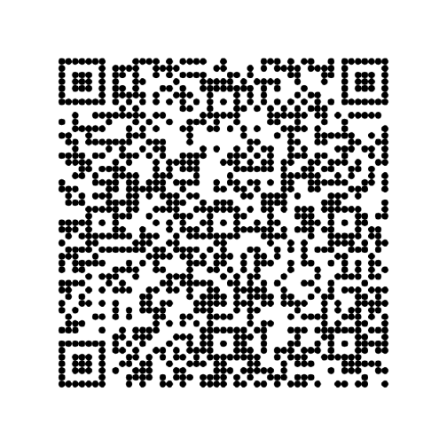
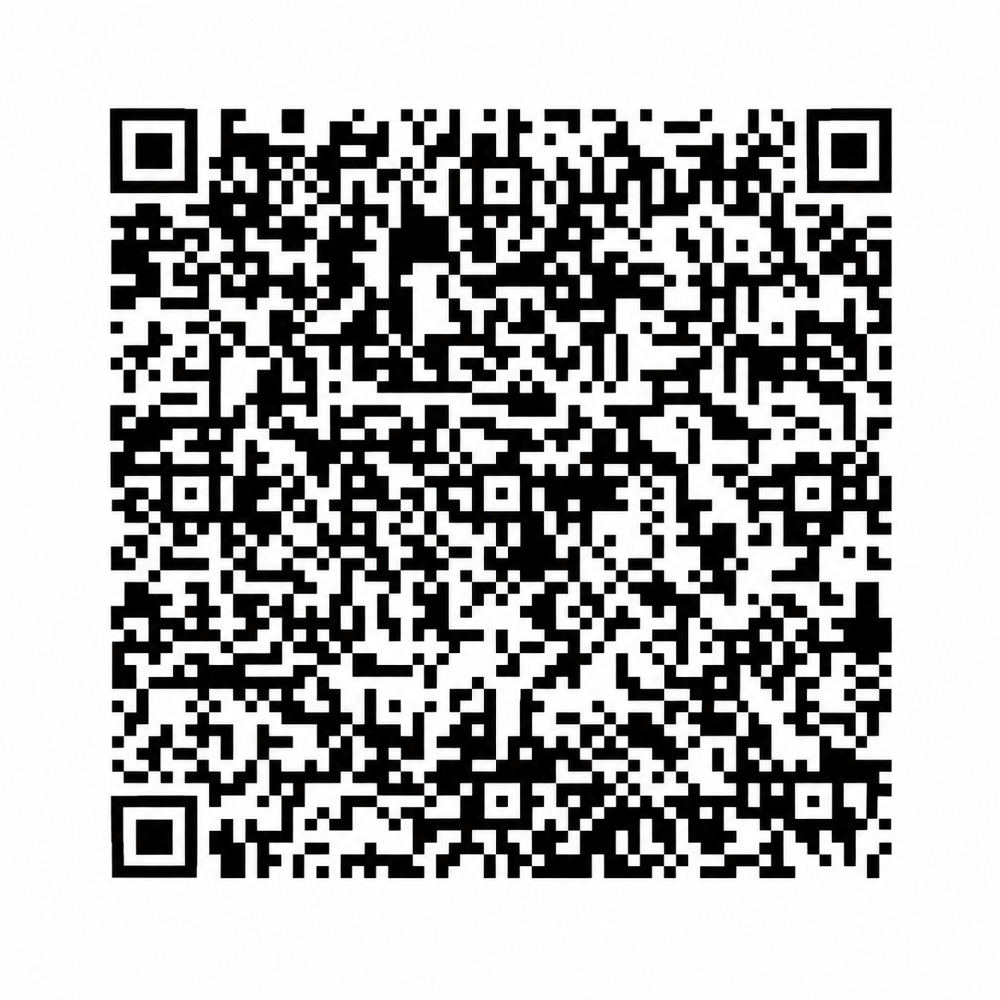

# Support Daily Plan

If this project saves you time, consider sponsoring its development. Your support helps me maintain it, improve the documentation, and build new features. Every contribution is appreciated. ❤️

<table>
  <tr>
    <td align="center">
      <strong>Venmo</strong> 
      
    </td>
    <td align="center">
      <strong>Zelle</strong> 
      
    </td>
  </tr>
  <tr>
    <td align="center">
      <strong>WeChat Pay</strong> 
      
    </td>
    <td align="center">
      <strong>Alipay</strong> 
      
    </td>
  </tr>
</table>

Scan with the corresponding payment app and confirm the recipient before sending.
The codes are visible here; opening an image at full size is optional.
For Zelle, use the Zelle feature in your bank's app.

The payment apps may display the recipient's name, profile picture and contact
details. Only receiving QR codes are provided here; never share a login or
verification code.

You can also help by sharing feedback, reporting reproducible bugs and improving
the documentation.

[Back to Daily Plan](README.md)
